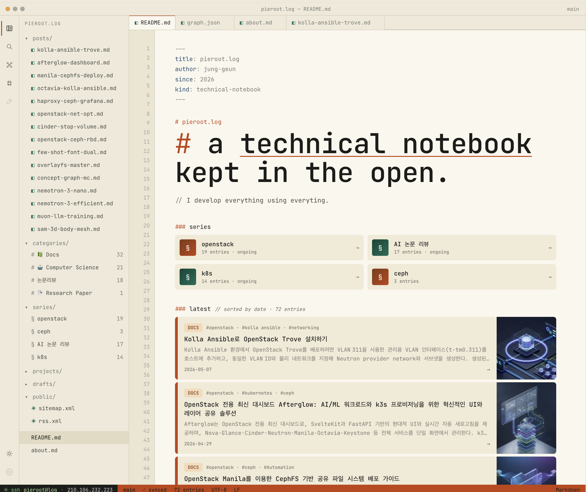
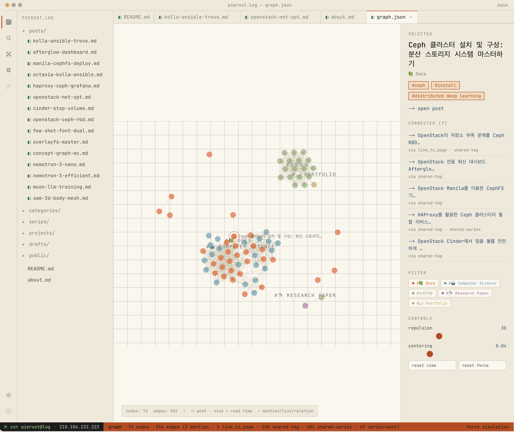
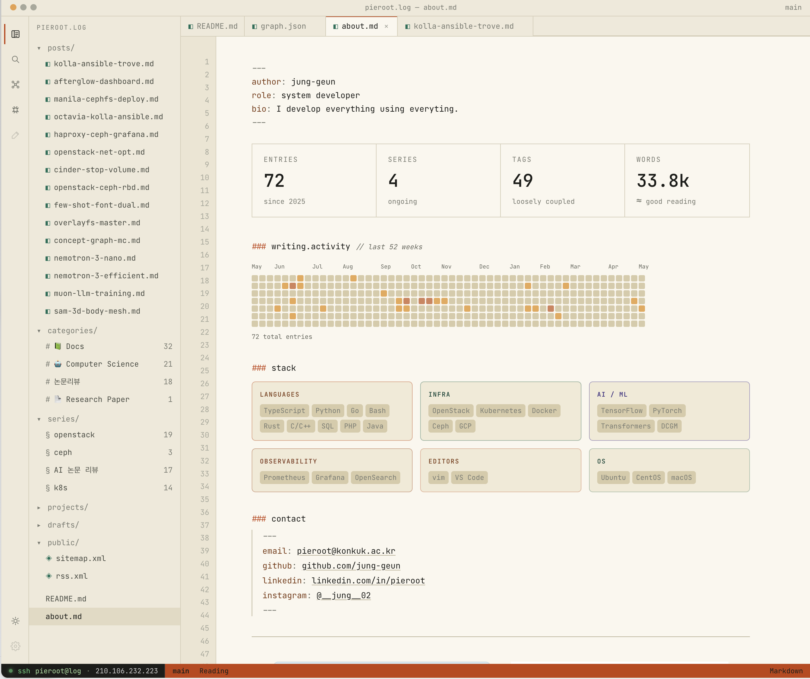

# monolog

> Notion을 CMS로 쓰는 IDE 스타일 기술 노트북.

**[blog.pieroot.xyz](https://blog.pieroot.xyz)** · 셋업 가이드 → [`docs/USAGE.md`](docs/USAGE.md) · 기능 상세 → [`docs/FEATURES.md`](docs/FEATURES.md)

[morethan-log](https://github.com/morethanmin/morethan-log)에서 출발했지만 UI · 라우트 · 데이터 계층을 거의 새로 짠 별개의 작업입니다. 화면 전체가 VS Code 에디터처럼 동작하고, 모든 페이지 이동은 SPA 전환으로 탭이 유지됩니다.

---







---

## 이 프로젝트만의 특징

### Editor chrome — 모든 라우트가 IDE
TitleBar · ActivityBar · FileTree · TabBar · StatusBar · LineNumberGutter가 전 라우트에 일관되게 깔립니다. 글 하나를 읽는 경험이 IDE에서 파일을 여는 경험과 같습니다. 각 라우트는 `useRegisterChrome(filename, statusItems, kind)`로 자기 메타와 탭 종류를 동적 등록합니다.

### `⌘K` 커맨드 팔레트 + 다중 탭
`⌘K` 하나로 Actions · Posts · Tags · Categories를 검색해 어디든 점프합니다. 글 탭은 `Alt/Option+W`로 닫고 `Alt/Option+Shift+T`로 다시 열 수 있습니다. 브라우저가 `Cmd/Ctrl+W`·`Cmd/Ctrl+Shift+T`를 페이지에 전달할 때만 같은 동작을 처리합니다. 사용자가 동의하면 열린 탭과 최근 닫은 글 주소를 이 브라우저에 저장해 새로고침 후 복원합니다. 탭 간 전환은 항상 새로고침 없는 SPA 이동 — FileTree · 본문 내 링크 모두 `router.push`로 처리됩니다.

`README.md`를 포함한 모든 탭은 마우스로 드래그해 순서를 바꿀 수 있습니다. 드래그 대신 탭바의 좌우 버튼을 클릭하거나 키보드로 실행해 현재 탭을 이동할 수도 있습니다. 순서를 바꿔도 현재 읽는 페이지는 유지되고, 탭 저장에 동의하면 바꾼 순서도 복원합니다.

### Three.js 3D 지식 그래프
Three.js 원근 카메라로 실제 포스트·태그·시리즈 관계를 탐색합니다. 포스트는 `google/embeddinggemma-2` 문서 벡터의 3D PCA 위치에 배치하고, 태그·시리즈는 실제 연결에 따라 XYZ 시뮬레이션으로 정렬합니다. 연결 수가 많은 노드일수록 더 투명하게 표시하고, 선명한 관계선과 frosted 라벨을 에디터 테마에 맞춥니다.

- **회전·이동·줌** — 왼쪽 드래그 회전, 오른쪽 또는 Shift+드래그 이동, 휠 줌. 모바일은 한 손가락 회전과 두 손가락 이동·핀치 줌
- **노드 이동** — Alt/Option+드래그. 임베딩된 포스트는 놓으면 벡터 위치로 돌아오고 나머지 노드는 3D 시뮬레이션이 재배치
- **관계 탐색** — 연결 방향·종류·강도를 색상과 화살표로 표시. 선택한 노드의 직접 연결을 강조하고, 연결만 보기·검색·포커스·본문 인용 근거 제공
- **의미 검색·관계** — Name 검색 외에 Meaning 검색으로 본문 의미가 비슷한 글을 찾습니다. 실제 벡터의 코사인 유사도와 온톨로지의 논리 관계를 점선으로 구분하고, 유사도를 명시적인 참조 관계나 확률로 표시하지 않습니다.
- **증분 임베딩** — 콘텐츠 유지보수에서 최초 공개·제목·본문 변경만 재계산하고 Qdrant에 영속 저장합니다. 정기 재검증·slug·태그 변경은 재임베딩하지 않습니다.
- **실시간 조절** — 허브와 아직 임베딩되지 않은 포스트의 force 설정을 변경해도 카메라·노드 상태를 유지. 시간순 재생·일시정지·되감기 지원
- **그래프 캐시** — 공개 글의 본문 해시와 메타데이터로 변경을 감지하고, 기존 Qdrant 스냅샷을 재사용합니다. 콘텐츠 동기화의 대기 작업을 `/api/cron/content`가 증분 갱신하며 `yarn warm:graph`로 수동 워밍할 수 있습니다.

### 안정 Notion 이미지 프록시 + 1GB LRU 디스크 캐시
S3 presigned URL이 ISR마다 만료돼도 프록시 URL(`?id=<uuid>&kind=s3`)은 고정 — 브라우저 캐시와 `next/Image` 옵티마이저가 정상 동작합니다. 401/403/410 응답 시 URL 자동 재발급, in-flight dedup으로 동일 이미지 중복 페치 차단.

### 자기 데이터 익명 댓글
외부 SaaS 없이 방문자 댓글을 본인 Notion `comments` DB에 직접 적재합니다. `SHA-256(slug + ipHash + salt)` 앞 4자로 자동 닉네임 생성, honeypot + IP rate limit 스팸 방어, Notion `Status` 필드 하나로 모더레이션.

### 증분 콘텐츠 동기화 + Cold start 없는 워밍
Notion webhook과 운영 호스트의 15분 cron 대조가 바뀐 글만 다시 가져오고 영향받는 경로만 재생성합니다. 발행본은 내구성 콘텐츠 레지스트리(AOF Redis)에 저장돼 Notion 장애·재시작 중에도 유지되고, slug 변경은 이전 주소에서 308로 이어집니다. Docker entrypoint는 `next start` 후 `/api/init`으로 레지스트리를 준비하고 모든 공개 경로를 워밍합니다. GitHub Actions schedule은 지연·누락 가능한 보조 트리거입니다.

---

## 스택

| 분류 | 기술 |
|---|---|
| Framework | Next.js 16 (Pages Router, `output: standalone`) |
| Language | TypeScript 6 strict |
| UI | React 19 · Emotion (CSS-in-JS) · Tailwind 3 |
| Data | TanStack Query v5 · `@notionhq/client` v5 · `react-notion-x` 7.x |
| Graph | Three.js · d3-force-3d (3D 뷰) · d3-force (서버·온톨로지) |
| Color | Radix Colors 2 (custom palette) |
| Test | Jest 30 + @swc/jest |
| Container | Docker Compose + GHCR (`linux/amd64` 운영 이미지) |

---

## 시작하기 — 직접 입력하는 콘텐츠 연결 정보는 2개

### 1. 준비

- **Node.js 22 또는 24 LTS**, **Yarn 1.22.22**, Git. Yarn이 없으면 `corepack enable`을 실행하고, 저장소를 clone한 뒤 그 디렉터리에서 `corepack install`로 선언된 Yarn 버전을 활성화합니다. Corepack이 없는 Node 배포판은 Yarn 1.22.22를 별도로 설치하세요.
- 서버 배포에는 **Docker Engine 또는 Docker Desktop + Docker Compose**가 필요합니다. 전체 스택에는 CPU 임베딩 서비스도 포함됩니다. 운영 이미지의 대상은 `linux/amd64`이며 ARM 호스트는 임베딩 서비스의 amd64 에뮬레이션을 지원해야 합니다.
- [**monolog blog assets**](https://www.notion.so/pieroot/blog-assets-35a067c015d080a0bf17d3a0dffb3784)를 본인 Notion 워크스페이스로 **Duplicate** 합니다.
- [Notion Integrations](https://www.notion.so/my-integrations)에서 읽기 권한이 있는 Internal Integration을 만들고, 복제한 **원본 `blog-table` DB**의 `... → Add connections`에서 연결합니다. 연결된 뷰가 아니라 원본 DB를 열어 주소를 복사합니다.

### 2. 최소 설정

```bash
git clone https://github.com/jung-geun/monolog.git
cd monolog
yarn install --frozen-lockfile
cp -n .env.example .env
chmod 600 .env
```

`.env`에서 다음 두 값만 채웁니다. 예시 문자열 대신 본인의 실제 값을 넣으세요.

| 직접 입력할 값 | 가져오는 곳 |
|---|---|
| `NOTION_TOKEN` | 생성한 Integration의 토큰 |
| `NOTION_DATASOURCE_ID` | 복제한 원본 `blog-table`의 **Notion DB 주소 전체**. 이미 알고 있는 data-source UUID도 가능 |

```bash
yarn setup
```

`yarn setup`은 DB 주소를 실제 data-source UUID로 바꾸고, 비어 있는 `REVALIDATE_SECRET`을 생성하며 `.env` 권한을 `0600`으로 설정합니다. 기존 키는 재실행해도 바꾸지 않습니다. DB에 data source가 여러 개라면 이름과 UUID를 안내하며, 사용할 UUID를 직접 지정해야 합니다. `.env.local`이나 셸의 동명 환경변수가 아니라 저장소 루트의 `.env`를 읽습니다.

댓글·방문자 통계·광고·Analytics·검색엔진 인증·Utterances·Anthropic·프록시 인증은 **선택 설정**입니다. 기본 실행에는 해당 DB나 서비스 ID가 필요하지 않습니다. 네이티브 개발의 콘텐츠 저장소는 `.content-state`, Compose에서는 별도 AOF Redis로 자동 설정됩니다.

### 3. 로컬 확인

```bash
yarn dev
```

`http://localhost:3000`에서 확인합니다. 네이티브 개발은 별도 임베딩/Qdrant 없이 글을 볼 수 있으며, 의미 검색·임베딩 좌표까지 사용하려면 아래 전체 Compose 스택을 실행합니다. 사이트 제목·프로필은 `site.config.js`에서 수정합니다.

### 4. Docker로 서버 배포

외부에 공개할 때는 **빌드 전에** `.env`의 `NEXT_PUBLIC_SITE_URL`을 본인의 실제 주소(예: `https://notes.example.com`)로 바꿉니다. canonical·RSS·sitemap 및 요청 origin에 사용되므로 공개 주소를 변경하면 다시 빌드해야 합니다. localhost에서만 확인할 때는 기본값 그대로 둡니다.

```bash
docker compose config --quiet
docker compose up -d --build --wait --wait-timeout 2400
docker compose ps
docker compose logs -f blog embedding
```

이 경로는 **웹·임베딩 이미지를 소스에서 빌드**하므로 이 프로젝트의 비공개 GHCR 패키지 접근 권한이 필요하지 않습니다. Redis·Qdrant·임베딩은 내부 네트워크에만 두고 웹의 3000번 포트를 엽니다. 첫 실행은 공개 모델 약 1.49GB 다운로드와 실제 CPU 추론 워밍을 포함하므로 충분한 디스크·메모리와 인터넷 연결이 필요합니다. 시작 시 `/api/init`이 Notion 콘텐츠와 공개 경로를 준비합니다. 상태는 `docker compose logs blog`에서 확인합니다.

모델의 짧은 readiness 추론과 전체 글의 임베딩 backfill은 메모리 요구량이 다릅니다. 여러 서비스를 함께 실행하는 8GiB Docker VM에서는 긴 글 backfill 중 OOM 종료가 관찰됐습니다. 모델이 재시작하거나 유지보수가 `503`·`pending`·`failed`를 반환하면 Docker/서버의 메모리 여유를 확보한 뒤 다시 실행하세요. `/api/init` 성공만으로 임베딩 완료를 판단하지 않습니다. 상세 확인 방법은 [`docs/USAGE.md`](docs/USAGE.md#embeddinggemma--qdrant--ontology)에 있습니다.

공개 도메인은 DNS와 HTTPS 리버스 프록시를 별도로 연결하세요. 기본값 `TRUSTED_PROXY_HOPS=0`은 전달된 IP 헤더를 신뢰하지 않습니다. 프록시 뒤에서 방문자별 IP 제한을 사용하려면 홉 수와 공유 인증키를 함께 설정하고 프록시가 인증 헤더를 덮어쓰게 해야 합니다. 상세 설정은 [`docs/USAGE.md`](docs/USAGE.md)를 따릅니다.

### 5. Notion 변경 자동 반영 (Linux 서버)

호스트에 Bash·curl·`flock`(util-linux)·cron이 있어야 합니다. 저장소 디렉터리에서 최초 유지보수를 실행합니다. 공개 모델에는 API 키가 필요하지 않으며, 이 단계가 임베딩 backfill도 처리합니다.

```bash
bash scripts/reconcile-content-host.sh
pwd
crontab -e
```

기존 cron은 지우지 말고 아래 한 줄을 추가합니다. `/absolute/path/monolog`는 `pwd`로 확인한 **본인의 절대 경로**로 교체하세요.

```cron
*/15 * * * * /bin/bash "/absolute/path/monolog/scripts/reconcile-content-host.sh" 2>&1 | /usr/bin/logger -t monolog-content-sync
```

스크립트는 자신의 저장소 `.env`에서 키를 읽어 로컬 3000번 포트에 요청하므로 cron에 비밀키를 적지 않습니다. 실제 자동 실행은 `journalctl -t monolog-content-sync --since today --no-pager`로 확인합니다. 운영 중 `docker compose down -v`로 콘텐츠·벡터·모델 볼륨을 삭제하지 마세요. 선택 기능과 Notion 스키마·백업·기존 운영 이미지 배포는 [`docs/USAGE.md`](docs/USAGE.md)를 참고하세요.

---

## License

[MIT](LICENSE) — 원본 [morethan-log](https://github.com/morethanmin/morethan-log)의 라이선스를 따릅니다.
