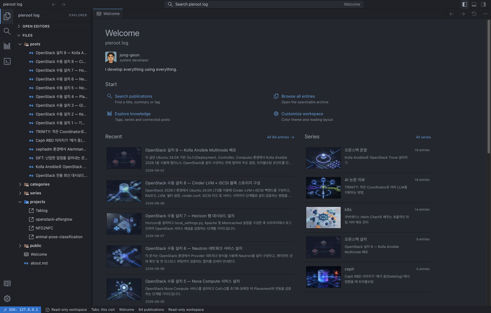
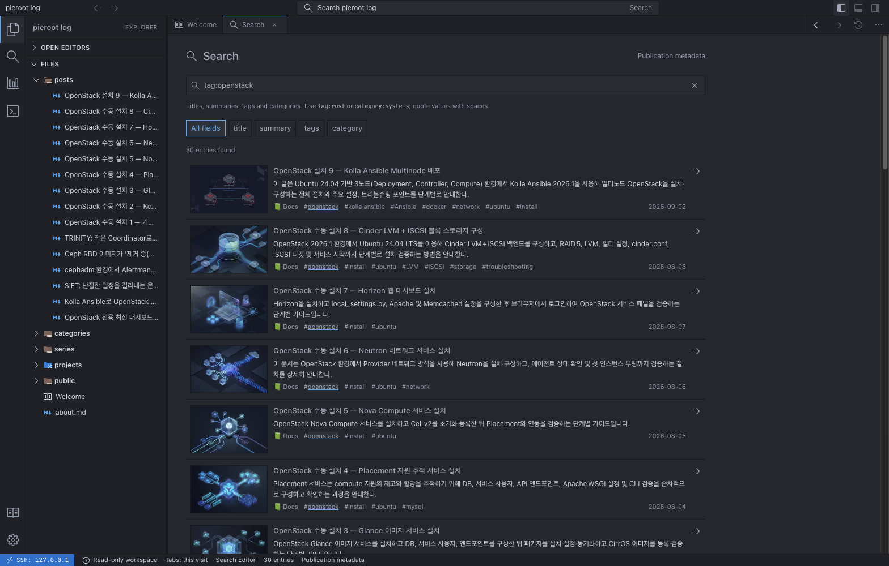
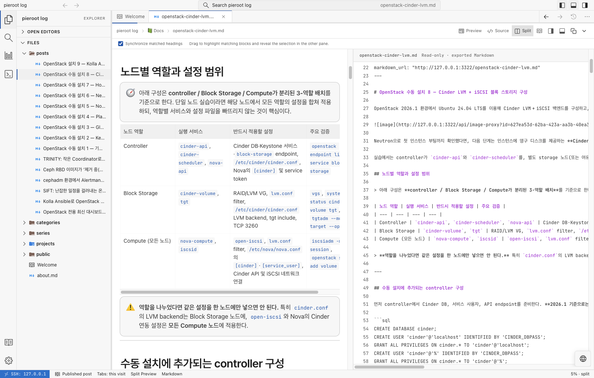
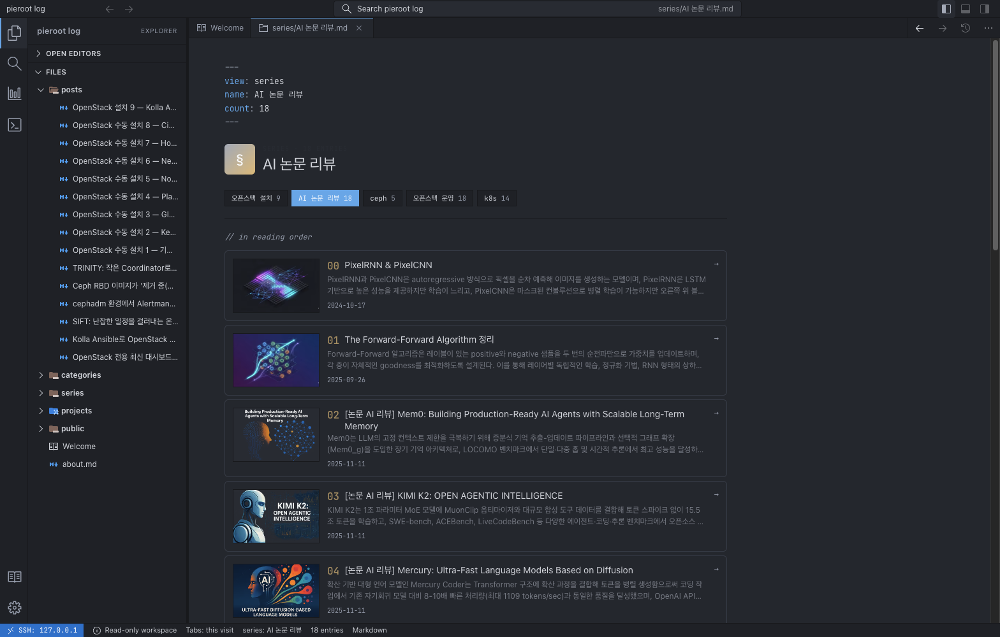
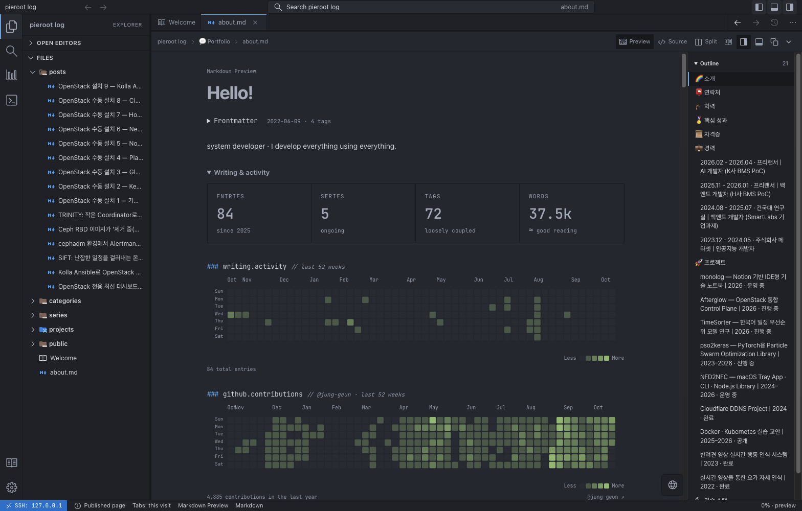
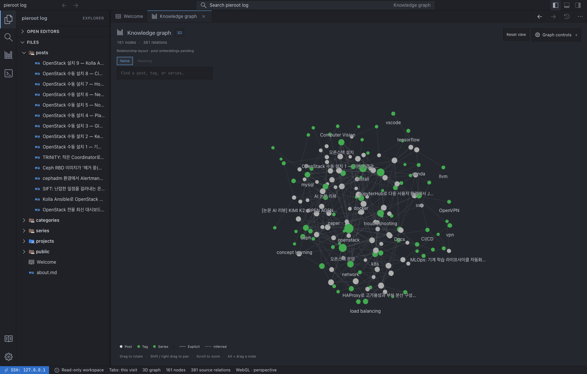
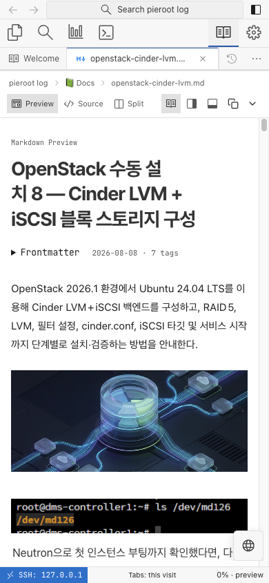

# Tablog

> Notion으로 쓰고, 에디터처럼 탐색하는 블로그.

**[개인 사이트 예시 · pieroot.xyz](https://pieroot.xyz)** · [English](README.en.md) · [설치·운영](docs/USAGE.md) · [기능 상세](docs/FEATURES.md) · [프로젝트 구조](project.md) · [디자인](DESIGN.md)

Tablog는 Notion에서 발행한 글을 탭·Explorer·검색·Outline으로 탐색하는 **VS Code 스타일의 읽기 전용 블로그**입니다. Preview · Source · Split을 같은 작업 공간에서 전환하며 페이지 이동 중 열린 탭을 유지합니다. Next.js Pages Router·ISR 기반의 동적 애플리케이션이며, 정적 export 전용 템플릿이나 실제 터미널·코드 편집기는 아닙니다.

## 화면 예시

**2026-10-21 캡처.** 현재 소스를 로컬에서 실행하고 실제 Notion 글로 캡처한 화면입니다. `pieroot log`·프로필·글·집계는 개인 사이트 설정의 예시이며, 설치 시 제공되는 기본 콘텐츠나 제품 이름이 아닙니다.



<details>
<summary>검색 · Split · 시리즈 · About · 그래프 · 모바일 화면</summary>

### 검색
`tag:openstack` 검색 결과와 실제 글 썸네일. 제목·요약·태그·카테고리를 검색하며 본문 전체 검색과는 구분합니다.



### Preview · Source · Split
Light Modern에서 같은 글의 렌더링된 표와 GFM Markdown Source를 함께 읽습니다. 표·코드·Source가 길어지면 해당 영역 안에서 가로 스크롤합니다.



### 시리즈
시리즈의 읽기 순서, 실제 글 제목·요약·날짜·썸네일을 표시합니다.



### About와 활동 달력
글 수·시리즈·태그·추정 단어 수와 Bklit UI Heatmap 기반의 글 활동·GitHub 기여 달력입니다.



### 3D 지식 그래프
중성 회색 포스트와 초록색 태그·시리즈, 연결 수에 따른 크기, 흐린 간선을 사용합니다. 예시는 관계 기반 배치이며, 임베딩 준비 상태는 화면 안내로 구분합니다.



### 모바일 읽기 모드
390px 화면의 실제 문서입니다. 좁은 편집기에서는 Split pane을 전환하고, 읽기 모드에서는 사이드바와 패널을 숨길 수 있습니다.



</details>

---

## 이 프로젝트만의 특징

### VS Code 방식의 읽기 전용 작업 공간
Command Center · Activity Bar · 크기 조절 사이드바 · Open Editors · 탭 · Outline · References/Comments 패널을 실제 블로그 동작에 연결합니다. Explorer 위에는 사이트 이름을, 파일 목록에는 URL 슬러그 대신 실제 글 제목을 표시합니다. 설정은 Activity Bar 하단의 **Settings** 한 곳과 같은 패널을 여는 명령으로 통합합니다. 상태 표시줄의 `SSH:` 배지는 방문자의 요청 주소를 보여주는 스타일 표현이며 실제 SSH 접속은 아닙니다.

기본 테마는 **One Dark Pro Mix**, 방문자 선택은 **Dark Modern · Light Modern · System**입니다. 운영자 기본값은 `site.config.js`의 `blog.theme`로 지정하고, 방문자의 저장된 선택이 우선합니다. Material Icon Theme 파일 아이콘과 Codicons를 사용하며 원본 라이선스를 보존합니다.

### Quick Pick · Preview 탭 · 검색
`⌘/Ctrl+K`는 파일 검색, `⌘/Ctrl+Shift+P` 또는 `>`는 명령, `@`는 현재 문서의 제목 검색입니다. Explorer 한 번 클릭은 교체 가능한 미리보기 탭, 두 번 클릭이나 **Keep open**은 고정 탭입니다. 탭은 드래그·좌우 버튼으로 정렬하고 `Alt/Option+W`로 글을 닫거나 `Alt/Option+Shift+T`로 다시 엽니다. 브라우저 고유 닫기 단축키는 가로채지 않습니다.

고정 탭·최근 닫은 글은 동의한 경우에만 브라우저에 저장하며 미리보기 탭·본문은 저장하지 않습니다. `/search?q=...`는 제목·요약·태그·카테고리 검색을 공유하고, Welcome·검색·시리즈는 각 글의 실제 썸네일을 사용합니다.

### 연결된 Preview · Source · Split
실제 Notion 본문은 서버 HTML에 포함됩니다. Source는 원본 Markdown·줄 번호를 지연 로드하고, Split은 대응하는 제목을 연결합니다. 한쪽에서 텍스트나 블록을 드래그해 선택하면 반대쪽 대응 영역을 강조하고 그 위치를 드러냅니다. 두 pane의 일반 스크롤을 항상 잠그는 방식은 아닙니다.

본문·Source·Outline·패널은 고정 작업 공간 안에서 독립적으로 스크롤합니다. 표는 GFM Markdown으로 내보내며 표·코드의 가로 넘침은 해당 영역 안에서 처리합니다. 실제 에디터 폭이 좁으면 Outline을 본문 위에 배치하고 Preview/Source pane을 전환합니다.

### 요청할 때만 실행하는 브라우저 내장 번역
본문 영역 우측 하단 지구본이나 Quick Pick의 **Translate: Article language…**에서 언어를 선택합니다. 지원하는 브라우저의 **Translator API**를 사용하며 특정 모델 이름을 가정하거나 클라우드 번역으로 대체하지 않습니다. 지원되는 비한국어 브라우저 환경에는 제안만 표시하고, 사용자가 번역을 요청해야 모델 다운로드·문장별 번역을 시작합니다.

Preview·Source·Outline·제목 검색은 같은 번역 스냅샷을 사용합니다. 부분 완료 상태를 남기는 취소와 원문 복원을 제공하며 코드·수식·링크 목적지는 보존합니다. 변경 텍스트의 짧은 재조합 효과는 선택 중이거나 동작 줄이기 설정에서는 생략합니다. **Markdown 복사·다운로드·공개 `.md`는 항상 원문입니다.**

### 관계 그래프와 활동 히트맵
**Three.js 3D 지식 그래프**는 실제 포스트·태그·시리즈의 연결을 탐색합니다. 포스트는 불투명한 중성 회색 구, 태그·시리즈는 초록색 구이며 연결 수에 따라 커집니다. 간선은 흐린 중성색으로 표시하고 선택·hover한 연결에만 방향 화살표를 드러냅니다. 모든 노드에 척력·충돌 방지를 적용하고, 준비된 문서 벡터의 PCA 위치는 약한 기준점으로만 사용합니다. Alt/Option+드래그를 놓아도 원래 위치로 순간 복귀하지 않습니다.

Name 검색과 관계 배치는 임베딩 의미 검색과 구분합니다. Meaning·유사 글 검색에는 **Qdrant와 공개 `google/embeddinggemma-2` 모델의 증분 인덱싱**이 필요하며 미구성·대기 상태를 명시합니다. 콘텐츠 초기화 성공만으로 임베딩 완료를 의미하지 않습니다. Ontology는 별도 엔터티·관계 뷰이며 선택적인 Anthropic 설정을 사용합니다.

About의 글 활동·GitHub 기여 달력은 저장소에 포함한 **Bklit UI Heatmap 소스**를 사용합니다. 3D 그래프와 온톨로지를 Bklit로 대체한 것은 아닙니다. 원본 건수·기여 레벨·날짜를 유지하고 작은 화면에서는 달력 안에서 가로 스크롤합니다.

### 내구성 게시본 · 증분 콘텐츠 동기화
Notion webhook과 운영 호스트의 15분 cron 대조가 바뀐 글과 영향받는 경로를 갱신합니다. 게시본은 만료되는 캐시와 별개인 콘텐츠 레지스트리에 저장하고, slug 변경은 이전 주소의 308 리다이렉트로 연결합니다. 전체 Compose는 별도 AOF Redis를, 네이티브 단일 호스트 개발은 `.content-state`를 사용합니다.

Docker entrypoint는 standalone Node 서버를 시작한 뒤 `/api/init`으로 게시본과 공개 경로를 준비합니다. 첫 초기화·이미지 다운로드·모델 backfill에는 시간이 필요하며 GitHub Actions schedule은 지연·누락 가능한 보조 트리거입니다. Notion 이미지 프록시는 만료된 URL 갱신·중복 요청 병합·디스크 캐시를 제공하고, 댓글·방문자 통계·광고·Analytics는 각각의 선택 설정과 준비 상태를 따릅니다.

광고는 **오버레이 전용 자동 모드**와 명시적인 **수동 배치 모드**를 구분하고 필수 설정이 없으면 비활성화합니다. 소스 설정이 Google 계정의 광고 형식을 바꾸거나 실제 광고 게재를 보장하지는 않습니다. 계정 확인·이미지 프록시·댓글 등의 준비 사항은 [운영 가이드](docs/USAGE.md)를 따릅니다.

---

## 스택

| 분류 | 기술 |
|---|---|
| Framework | Next.js 16 (Pages Router, `output: standalone`) |
| Language | TypeScript 6 strict |
| UI | React 19 · Emotion (CSS-in-JS) · Tailwind 4 |
| Data | TanStack Query v5 · `@notionhq/client` v5 · `react-notion-x` 7.x |
| Charts / Graph | Bklit UI Heatmap 소스 · visx · Three.js · d3-force-3d · d3-force |
| Color / Icons | One Dark Pro Mix · VS Code Modern · Material Icon Theme · Codicons |
| Test | Jest 30 + @swc/jest |
| Container | Docker Compose + GHCR (`linux/amd64` 운영 이미지) |

---

## 시작하기 — 콘텐츠 연결 정보는 2개

### 1. 준비

- **Node.js 22 또는 24 LTS**, **Yarn 1.22.22**, Git. Yarn이 없으면 `corepack enable`을 실행하고, 저장소를 clone한 뒤 그 디렉터리에서 `corepack install`로 선언된 Yarn 버전을 활성화합니다. Corepack이 없는 Node 배포판은 Yarn 1.22.22를 별도로 설치하세요.
- 서버 배포에는 **Docker Engine 또는 Docker Desktop + Docker Compose**가 필요합니다. 전체 스택에는 CPU 임베딩 서비스도 포함됩니다. 운영 이미지의 대상은 `linux/amd64`이며 ARM 호스트는 임베딩 서비스의 amd64 에뮬레이션을 지원해야 합니다.
- [**Notion 블로그 템플릿**](https://www.notion.so/pieroot/blog-assets-35a067c015d080a0bf17d3a0dffb3784)를 본인 Notion 워크스페이스로 **Duplicate** 합니다.
- [Notion Integrations](https://www.notion.so/my-integrations)에서 읽기 권한이 있는 Internal Integration을 만들고, 복제한 **원본 `blog-table` DB**의 `... → Add connections`에서 연결합니다. 연결된 뷰가 아니라 원본 DB를 열어 주소를 복사합니다.

### 2. 최소 설정

```bash
git clone https://github.com/jung-geun/tablog.git
cd tablog
yarn install --frozen-lockfile
cp -n .env.example .env
chmod 600 .env
```

`.env`에서 다음 두 값만 채웁니다. 예시 문자열 대신 본인의 실제 값을 넣으세요.

| 직접 입력할 값 | 가져오는 곳 |
|---|---|
| `NOTION_TOKEN` | 생성한 Integration의 토큰 |
| `NOTION_DATASOURCE_ID` | 복제한 원본 `blog-table`의 **Notion DB 주소 전체**. 이미 알고 있는 data-source UUID도 가능 |

```bash
yarn setup
```

`yarn setup`은 DB 주소를 실제 data-source UUID로 바꾸고, 비어 있는 `REVALIDATE_SECRET`을 생성하며 `.env` 권한을 `0600`으로 설정합니다. 기존 키는 재실행해도 바꾸지 않습니다. DB에 data source가 여러 개라면 이름과 UUID를 안내하며, 사용할 UUID를 직접 지정해야 합니다. `.env.local`이나 셸의 동명 환경변수가 아니라 저장소 루트의 `.env`를 읽습니다.

댓글·방문자 통계·광고·Analytics·검색엔진 인증·Utterances·Anthropic·프록시 인증은 **선택 설정**입니다. 기본 실행에는 해당 DB나 서비스 ID가 필요하지 않습니다. 네이티브 개발의 콘텐츠 저장소는 `.content-state`, Compose에서는 별도 AOF Redis로 자동 설정됩니다.

**Notion 이미지·썸네일을 사용하려면 `COMMENT_HASH_SALT`도 필요합니다.** 이미지 프록시의 IP 제한이 이 비밀값을 사용하므로 댓글을 꺼도 필요합니다. `yarn setup`은 댓글 DB를 설정한 경우에만 이 salt를 생성합니다. 설정하지 않았다면 아래 명령으로 한 번 생성한 값을 `.env`의 `COMMENT_HASH_SALT`에 넣고 보존하세요. 실제 비밀값을 커밋하거나 공개하지 마세요.

```bash
node -p "require('node:crypto').randomBytes(32).toString('hex')"
```

### 3. 로컬 확인

```bash
yarn dev
```

`http://localhost:3000`에서 확인합니다. 네이티브 개발은 별도 임베딩/Qdrant 없이 글을 볼 수 있으며, 의미 검색·임베딩 좌표까지 사용하려면 아래 전체 Compose 스택을 실행합니다. 사이트 제목·프로필은 `site.config.js`에서 수정합니다.

### 4. Docker로 서버 배포

기존 설치는 디렉터리를 옮길 필요가 없습니다. 경로를 바꾸거나 새 경로에서 기존 데이터를 이어 쓰려면 **Compose 실행 전에 기존 프로젝트 이름을 고정**하세요. [이름 변경과 데이터 보존 안내](docs/USAGE.md#기존-설치의-이름-변경)를 먼저 따릅니다.

외부에 공개할 때는 **빌드 전에** `.env`의 `NEXT_PUBLIC_SITE_URL`을 본인의 실제 주소(예: `https://notes.example.com`)로 바꿉니다. canonical·RSS·sitemap 및 요청 origin에 사용되므로 공개 주소를 변경하면 다시 빌드해야 합니다. localhost에서만 확인할 때는 기본값 그대로 둡니다.

```bash
docker compose config --quiet
docker compose up -d --build --wait --wait-timeout 2400
docker compose ps
docker compose logs -f blog embedding
```

이 경로는 **웹·임베딩 이미지를 소스에서 빌드**하므로 이 프로젝트의 비공개 GHCR 패키지 접근 권한이 필요하지 않습니다. Redis·Qdrant·임베딩은 내부 네트워크에만 두고 웹의 3000번 포트를 엽니다. 첫 실행은 공개 모델 약 1.49GB 다운로드와 실제 CPU 추론 워밍을 포함하므로 충분한 디스크·메모리와 인터넷 연결이 필요합니다. 시작 시 `/api/init`이 Notion 콘텐츠와 공개 경로를 준비합니다. 상태는 `docker compose logs blog`에서 확인합니다.

모델의 짧은 readiness 추론과 전체 글의 임베딩 backfill은 메모리 요구량이 다릅니다. 여러 서비스를 함께 실행하는 8GiB Docker VM에서는 긴 글 backfill 중 OOM 종료가 관찰됐습니다. 모델이 재시작하거나 유지보수가 `503`·`pending`·`failed`를 반환하면 Docker/서버의 메모리 여유를 확보한 뒤 다시 실행하세요. `/api/init` 성공만으로 임베딩 완료를 판단하지 않습니다. 상세 확인 방법은 [`docs/USAGE.md`](docs/USAGE.md#embeddinggemma--qdrant--ontology)에 있습니다.

공개 도메인은 DNS와 HTTPS 리버스 프록시를 별도로 연결하세요. 기본값 `TRUSTED_PROXY_HOPS=0`은 전달된 IP 헤더를 신뢰하지 않습니다. 프록시 뒤에서 방문자별 IP 제한을 사용하려면 홉 수와 공유 인증키를 함께 설정하고 프록시가 인증 헤더를 덮어쓰게 해야 합니다. 상세 설정은 [`docs/USAGE.md`](docs/USAGE.md)를 따릅니다.

### 5. Notion 변경 자동 반영 (Linux 서버)

호스트에 Bash·curl·`flock`(util-linux)·cron이 있어야 합니다. 저장소 디렉터리에서 최초 유지보수를 실행합니다. 공개 모델에는 API 키가 필요하지 않으며, 이 단계가 임베딩 backfill도 처리합니다.

```bash
bash scripts/reconcile-content-host.sh
pwd
crontab -e
```

기존 cron은 지우지 말고 아래 한 줄을 추가합니다. `/absolute/path/tablog`는 `pwd`로 확인한 **본인의 절대 경로**로 교체하세요. 기존 설치 경로를 유지했다면 그 경로를 사용합니다.

```cron
*/15 * * * * /bin/bash "/absolute/path/tablog/scripts/reconcile-content-host.sh" 2>&1 | /usr/bin/logger -t tablog-content-sync
```

스크립트는 자신의 저장소 `.env`에서 키를 읽어 로컬 3000번 포트에 요청하므로 cron에 비밀키를 적지 않습니다. 실제 자동 실행은 `journalctl -t tablog-content-sync --since today --no-pager`로 확인합니다. 운영 중 `docker compose down -v`로 콘텐츠·벡터·모델 볼륨을 삭제하지 마세요. 선택 기능과 Notion 스키마·백업·기존 운영 이미지 배포는 [`docs/USAGE.md`](docs/USAGE.md)를 참고하세요.

---

## License

[MIT](LICENSE) — Tablog는 [morethan-log](https://github.com/morethanmin/morethan-log)에서 출발했습니다. 원본 저작권·라이선스와 사용한 에셋의 개별 라이선스를 유지합니다.
